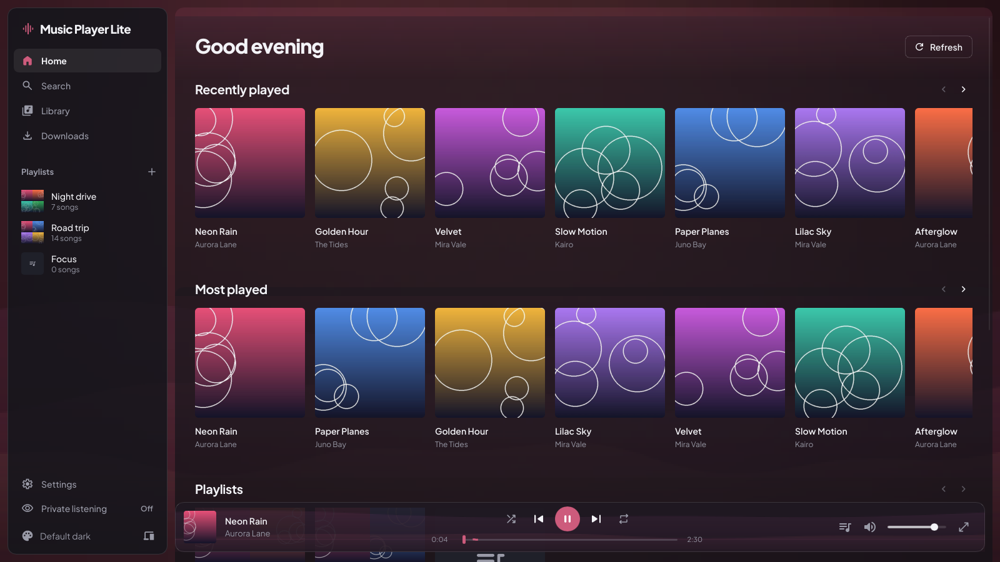
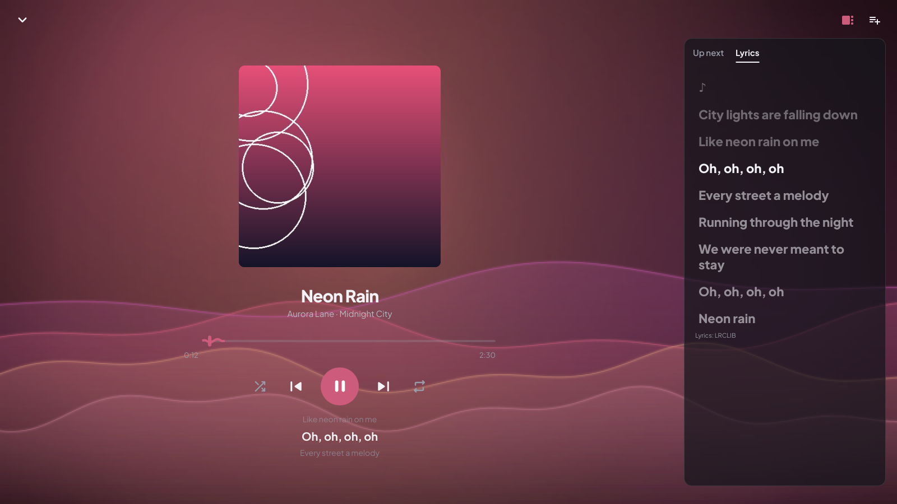
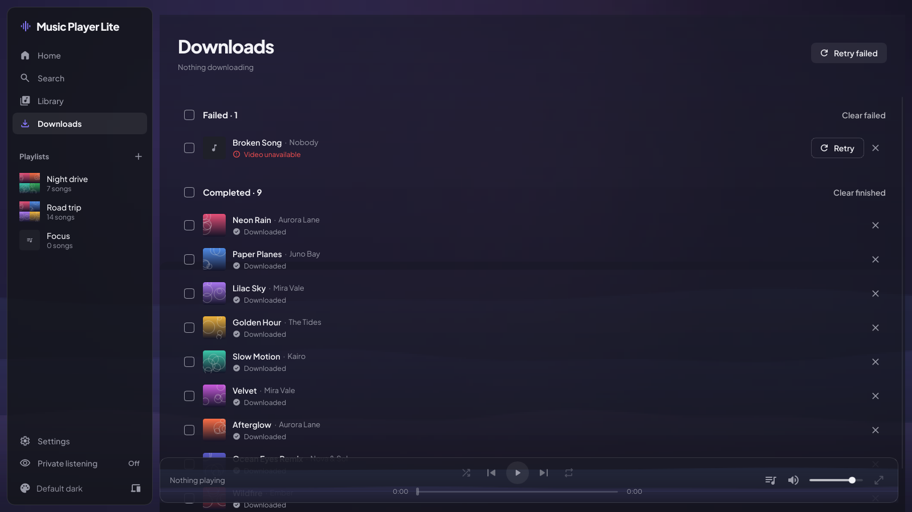
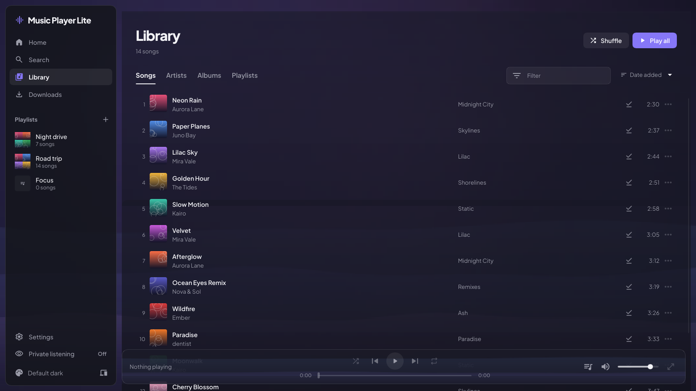
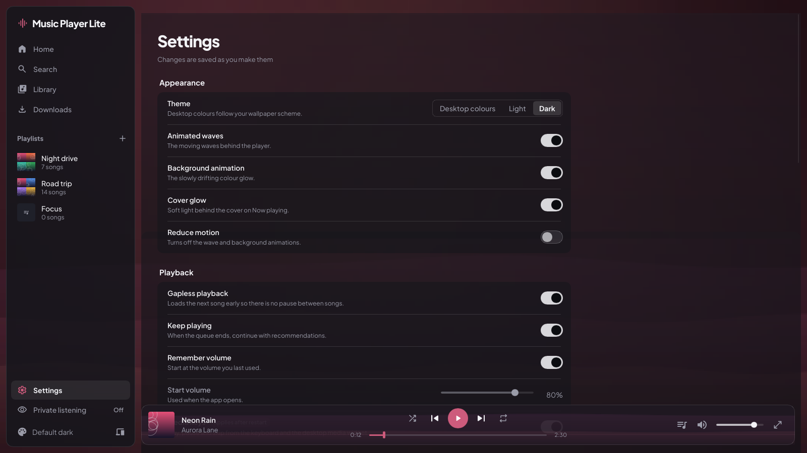
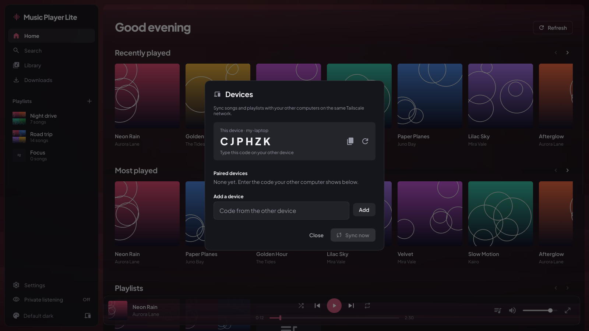
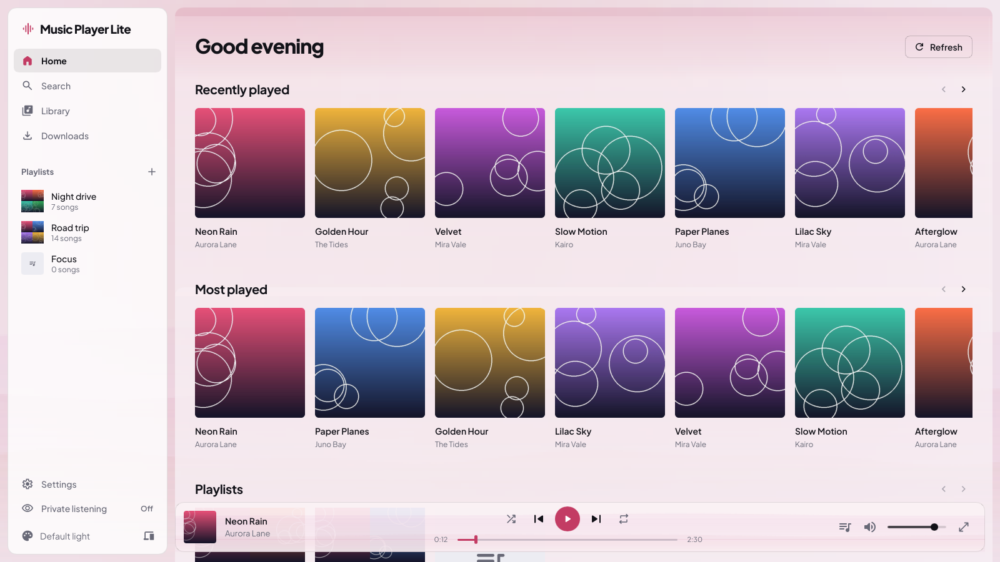

# Music Player Lite

> [!IMPORTANT]
> **This project was made mostly by AI.**
> Most of the code (the Rust server, the YouTube Music client, the audio engine,
> the Slint desktop app, the setup scripts, the tests and this README) was generated
> by **Claude** (Anthropic's AI model, Opus 5.5) running in Claude Code. My part was
> the idea, the feature requests, testing it and giving feedback. It started as a
> test to compare AI coding models on the same prompt.

> [!NOTE]
> For personal use only. The app downloads audio from YouTube / YouTube Music with
> yt-dlp; respect YouTube's Terms of Service and copyright law in your country, and
> "only download music you have the right to".

A small, fast desktop music player for Linux, macOS and Windows in the spirit of
YouTube Music and Spotify. Search YouTube Music, download songs or whole playlists
as tagged MP3s, build playlists, play everything locally, and get a "For You" feed
plus a daily Discover Mix based on what you actually listen to.

Music Player Lite is an all-Rust rewrite of
[Geonix Music Player](https://github.com/danielaufnahme-cmd/geonix-music-player)
(Flutter app + Rust backend + Python worker) with the same features and look, built
to use as little memory and CPU as possible: **one process, one ~33 MB binary,
about 45 MB of RAM and 0% CPU when idle.**

**Highlights**

- Search YouTube Music (songs only), preview anything, download songs or whole
  playlists as MP3s with ID3 tags and cover art (yt-dlp + ffmpeg).
- Library with Songs, Artists, Albums and Playlists, playlist ordering, synced lyrics
  (karaoke highlight) and an editable "Up next" queue.
- "For You" home screen and a daily **Discover Mix** built from your own listening.
- **Private listening:** one click pauses your listening history and recommendations.
- **Device sync:** pair your computers with a 6-letter code and they copy songs and
  playlists to each other over [Tailscale](https://tailscale.com). Additive, never deletes.
- **Phone extras (optional):** add music from a phone web page, and listen on the
  phone through Navidrome + Amperfy.
- **Settings page** with export / import of all settings to one file.
- Media keys and the desktop media widget (MPRIS on Linux), light and dark theme,
  accent colour from the playing cover.
- Everything stays on your machine.

> **Install it:** jump to [Installation](#installation) at the end.

## Screenshots



| Now Playing (synced lyrics) | Downloads |
|---|---|
|  |  |

| Library | Settings |
|---|---|
|  |  |

| Device sync | Light theme |
|---|---|
|  |  |

## Light on resources

Measured on Linux with the default software renderer (no GPU memory at all), window
1700×950, the server built into the same process:

| State | RAM (RSS) | CPU |
|---|---|---|
| Idle | 45 MB | 0.0 % |
| Playing, main window | 48 MB | 2.7 % |
| Playing, Now Playing with animated waves | 56 MB | 5.6 % |
| Paused | 47 MB | 0.05 % |
| Server only (`--headless`, for the phone) | 15 MB | 0.0 % |

The animations can be turned down or off in Settings (frame rate, waves, background
animation, reduce motion), and the audio device is released after 30 s of pause.
yt-dlp and ffmpeg only run while something downloads.

## Using it

- **Search** YouTube Music for songs only; videos, podcasts and user uploads are filtered out.
  Click a result to preview it, or use the download button.
- **Playlist import:** paste a YouTube or YouTube Music playlist link into Search to
  preview it, then "Download all". A local playlist with the same name and order
  appears immediately and fills up as songs finish downloading. A song link pasted
  into Search shows just that song.
- **Links:** `music.youtube.com`, `www.youtube.com`, `m.youtube.com` and `youtu.be`
  links work, with or without `https://` and extra parameters like `&si=`:
  `playlist?list=…`, album pages (`browse/MPRE…`), `watch?v=…`, `shorts/…`. A
  `watch?v=…&list=…` link counts as the playlist in Search; the phone page asks.
  Regular YouTube playlists work too, not only YouTube Music ones.
- **Download queue:** up to 4 downloads at once (3 by default), with live progress,
  speed and a "converting" step while the MP3 is made. Failed downloads show the reason and a Retry button. Songs already in your
  library are skipped.
- **Library:** Songs, Artists, Albums and Playlists views, an instant text filter and
  sorting. Play counts and the last-played time are tracked.
- **Playlists:** create, rename, delete, add or remove songs and reorder them. Deleting
  a playlist never deletes files.
- **Player:** play/pause, next, previous, seek, volume, shuffle, repeat (off/all/one),
  gapless playback, and a full-screen Now Playing view with lyrics and the queue.
- **For You:** the Home screen has Recently played, Most played, Recommended and
  "Because you listened to …". The Discover Mix is rebuilt with a button and
  automatically once a day.
- **Private listening:** the toggle in the sidebar. While it is on, songs you play don't
  change play counts, "Recently played", "Most played" or recommendations.
- **Keyboard:** Space toggles play/pause, Ctrl+→ and Ctrl+← skip to the next or
  previous song, Ctrl+F opens Search. In Downloads, Ctrl+A selects all and Delete
  removes the selection.
- **Settings:** theme, animations, playback, lyrics, download quality and folder,
  parallel downloads, recommendations, device sync, phone page, performance (frame
  rate, GPU renderer, cover cache) and **Export / Import / Reset** of all settings
  (app and server) as one JSON file.

### How recommendations work

Up to 10 seed songs are taken: your 5 most played and your 5 most recently added.
For each seed the app asks YouTube Music for its radio (the songs it would play next).
Songs found through several seeds score highest, and an earlier position in a seed's
list breaks ties. Songs already in your library are removed, and no artist may fill
more than 4 spots. Each recommendation remembers which seed found it, which powers
"Because you listened to …".

## Sync between devices and the phone (optional)

Everything in this section is optional. The player works fine on a single computer
without Tailscale, Navidrome or a phone.

### Sync between devices

Every computer runs its own copy of Music Player Lite with its own library. Sync copies
songs and playlists between them, directly from computer to computer.

**Requirements**

- [Tailscale](https://tailscale.com/download) on every device, all logged in to the
  same tailnet.
- Music Player Lite open (or running as a service, see below) on the devices you sync.
- The sync port **7903/TCP** reachable over Tailscale. Only Tailscale addresses
  (100.64.0.0/10, fd7a:115c:a1e0::/48) and localhost are accepted. If you run a
  firewall, allow 7903 on the Tailscale interface (examples below). Change the port
  with `GEONIX_SYNC_PORT` on all devices.

Firewall examples, use the one for your system:

```bash
sudo ufw allow in on tailscale0 to any port 7903 proto tcp
```

```bash
sudo firewall-cmd --zone=trusted --add-interface=tailscale0 --permanent
```

```powershell
New-NetFirewallRule -DisplayName "Music Player Lite sync" -Direction Inbound -Protocol TCP -LocalPort 7903 -RemoteAddress 100.64.0.0/10 -Action Allow
```

**Pairing**

1. Click the **devices** icon at the bottom of the sidebar. It shows this device's
   **6-letter code**.
2. On the other device, open the same dialog and type that code under **Add a device**.
   The app finds the device with that code among the online devices on your tailnet;
   no IP addresses needed. Both devices remember each other; the code changes after
   each pairing (or when you click the refresh button).
3. Pair as many devices as you like.

**Syncing**

- **Sync now** pulls everything the other device has and asks it to pull from you, so
  both end up with all songs and playlists.
- With "Sync when the app opens" (Settings → Sync) it syncs automatically at start.
- Sync is **additive and never deletes anything**: missing songs are copied, playlists
  are matched by name and missing songs are appended. The Discover Mix stays per device.

### Adding music from the phone

The server also serves a phone-friendly page (Settings → Phone page): paste a YouTube /
YouTube Music link and it detects what it is.

- **Song:** preview with an "In library" badge, then Download.
- **Playlist or album:** preview of every song and three options: create a new
  playlist, add to an existing playlist, or download the songs only.
- Live progress, retry for failed songs, and a list of recent downloads.

The server listens on `127.0.0.1` only. To reach the page from a phone on your tailnet,
publish it with Tailscale Serve (on Linux run it with `sudo`, or run
`sudo tailscale set --operator=$USER` once):

```bash
tailscale serve --bg --https=7902 http://127.0.0.1:7902
```

Then open `https://your-pc.your-tailnet.ts.net:7902` on the phone (your machine's name
and tailnet are shown by `tailscale status`) and add it to the home screen.

The page only works while the server runs: either keep the app open, or let it run
all the time without a window. On Linux with systemd, `setup.sh` installs a user
service for that:

```bash
./setup.sh --service
```

It runs `music-player-lite --headless` (about 15 MB of RAM). The desktop app sees the
running server on the same port and uses it. Remove the service again with
`./setup.sh --remove-service`. On macOS or Windows start `music-player-lite --headless`
(or `geonix-lite.exe --headless`) with your system's autostart instead.

### Listening on the phone (Navidrome + Amperfy)

The library can also be streamed to a phone with [Navidrome](https://www.navidrome.org)
(a Subsonic-compatible music server) and a Subsonic app such as **Amperfy** (iPhone)
or Symfonium / Tempo (Android), over Tailscale. Navidrome only needs the music folder;
three small optional helpers (Python 3, standard library only) keep playlists and new
songs in step. `setup.sh` installs them next to the app in
`~/.local/lib/music-player-lite/`:

| File | What it does |
|---|---|
| `sync_playlists.py` | Exports the app's playlists as `.m3u8` files into `<music folder>/Playlists/`, which Navidrome imports. Only downloaded songs are included; the Discover Mix is skipped. Only files it created are ever removed. |
| `navidrome_rescan.py` | Asks Navidrome to rescan now, using Subsonic token auth (the password is never sent in plain text). Reads the login from `~/.config/navidrome/LOGIN.txt` (or `NAVIDROME_LOGIN_FILE`) and the server from `NAVIDROME_URL` (default `http://127.0.0.1:4533`). Does nothing if the file is missing. |
| `after_downloads.sh` | Runs the two above. Point `GEONIX_AFTER_DOWNLOADS` at it and the app runs it about 10 s after downloads or playlist imports finish, so new songs reach the phone within about a minute. |

Setup (Linux example):

1. Install Navidrome (see
   [navidrome.org/docs/installation](https://www.navidrome.org/docs/installation/)) and
   set its music folder to the app's music folder, e.g. in `navidrome.toml`:
   `MusicFolder = "/home/you/Music/Geonix-lite"` and `Address = "127.0.0.1"`.
   Create your Navidrome user in its web UI (`http://127.0.0.1:4533`).
2. Save that login for the rescan helper and keep it private:
   ```bash
   mkdir -p ~/.config/navidrome
   printf 'Username: you\nPassword: your-navidrome-password\n' > ~/.config/navidrome/LOGIN.txt
   chmod 600 ~/.config/navidrome/LOGIN.txt
   ```
3. Tell the app to run the helper after downloads, in its config file:
   ```bash
   mkdir -p ~/.config/geonix-lite
   echo 'GEONIX_AFTER_DOWNLOADS=~/.local/lib/music-player-lite/after_downloads.sh' >> ~/.config/geonix-lite/geonix.env
   ```
   Restart the app (and the service, if you use it:
   `systemctl --user restart music-player-lite`).
4. Publish Navidrome on your tailnet:
   ```bash
   tailscale serve --bg --https=4533 http://127.0.0.1:4533
   ```
   and in the phone app use the server `https://your-pc.your-tailnet.ts.net:4533`.

## Configuration

Most things are in the app's **Settings** page. The rest are environment variables.

**Config file (optional, Linux and macOS).** The launcher (`launch.sh`, installed as
`music-player-lite`) reads `~/.config/geonix-lite/geonix.env` if it exists (or the file
named by `GEONIX_CONFIG`; `$XDG_CONFIG_HOME` is respected). One `KEY=VALUE` per line,
`#` comments allowed, `~` and `$HOME` are expanded, and real environment variables
always win over the file. Example:

```bash
GEONIX_PORT=7902
GEONIX_MUSIC_DIR=~/Music/Geonix-lite
```

On Windows set the variables in your user environment instead.

**Where your data goes:**

| | Library database, covers, `launch.log` | Music | App settings (`ui.json`) |
|---|---|---|---|
| Linux | `~/.local/share/geonix-lite` | `~/Music/Geonix-lite` | `~/.config/geonix-lite` |
| macOS | `~/Library/Application Support/geonix-lite` | `~/Music/Geonix-lite` | `~/Library/Application Support/geonix-lite` |
| Windows | `%LOCALAPPDATA%\geonix-lite` | `%USERPROFILE%\Music\Geonix-lite` | `%APPDATA%\geonix-lite` |

The download folder can also be changed in Settings → Downloads.

**Environment variables:**

| Variable | Default | Meaning |
|---|---|---|
| `GEONIX_PORT` | `7902` | Server port on 127.0.0.1 (app, phone page) |
| `GEONIX_SYNC_PORT` | `7903` | Device-sync listener (Tailscale and localhost peers only) |
| `GEONIX_DATA_DIR` | see table above | Library database and cover cache |
| `GEONIX_MUSIC_DIR` | see table above | Where MP3s are saved |
| `GEONIX_AFTER_DOWNLOADS` | *(none)* | Command run ~10 s after downloads or imports settle (see [Navidrome](#listening-on-the-phone-navidrome--amperfy)) |
| `GEONIX_YTDLP` / `GEONIX_FFMPEG` | `PATH`, then next to the binary | yt-dlp and ffmpeg to use |
| `GEONIX_TAILSCALE` | `tailscale` on `PATH`, then the standard macOS / Windows install paths | Tailscale CLI used to find devices when pairing |
| `GEONIX_DEVICE_NAME` | the computer's host name | Name shown to your other devices |
| `GEONIX_RENDERER` | the "GPU renderer" setting | `software` or `femtovg` (OpenGL) |
| `GEONIX_UI_SETTINGS` | `ui.json` in the folder above | App settings file |
| `GEONIX_CONFIG` | `~/.config/geonix-lite/geonix.env` | Config file read by the launcher |
| `RUST_LOG` | `info` | Log level of the standalone `geonix-server` binary |

**Command line:** `music-player-lite --headless` runs only the server (no window);
`music-player-lite --help` lists all options.

## Troubleshooting

- **Something failed at start:** run `music-player-lite` (or `./launch.sh`) in a
  terminal to see the messages. When started from the app menu they go to `launch.log`
  in the data folder (table above).
- **Downloads fail with HTTP 403 or extraction errors:** YouTube changed something;
  update yt-dlp (`sudo pacman -Syu yt-dlp`, `sudo dnf upgrade yt-dlp`,
  `brew upgrade yt-dlp`, `winget upgrade yt-dlp.yt-dlp`). On Debian / Ubuntu `setup.sh`
  installs its own copy that updates itself weekly; `./setup.sh --local-ytdlp` does
  that on any system.
- **Downloads fail with "Conversion to MP3 failed":** install `ffmpeg`.
- **No sound (Linux):** the app plays through ALSA, which PipeWire and PulseAudio
  provide. Check that `pipewire-alsa` (or `pulseaudio-alsa`) is installed.
- **The window looks wrong or is slow with a GPU problem:** turn off Settings →
  Performance → GPU renderer (the default software renderer needs no GPU), or start
  with `GEONIX_RENDERER=software`.
- **Port 7902 is already in use:** set another `GEONIX_PORT` (config file or environment).
- **Windows: `setup.ps1` cannot be loaded because running scripts is disabled:** start it
  with `powershell -ExecutionPolicy Bypass -File .\setup.ps1`.
- **Device sync finds no device:** both devices must be online in the same tailnet
  (`tailscale status`), have the app (or the service) running, and allow port 7903 on
  the Tailscale interface.

## How it works (for developers)

One Cargo workspace, four crates:

| Crate | Job |
|---|---|
| `crates/ui` | Slint desktop app, binary `geonix-lite`. Talks to the server over HTTP + Server-Sent Events, starts the server in-process when none answers on the port. `--headless` runs only the server. |
| `crates/server` | axum + SQLite (bundled): library, playlists, download queue, recommendations, lyrics, settings, audio streaming with Range support, phone page, device sync. Also a standalone binary `geonix-server`. |
| `crates/yt` | YouTube Music client (InnerTube API with reqwest), downloads through yt-dlp + ffmpeg, ID3 tagging, lyrics from LRCLIB and YouTube Music, recommendations. |
| `crates/player` | Audio engine: symphonia decoding + cpal output, local files and HTTP streams, gapless preload, media keys (souvlaki). |

```
Slint UI ──HTTP/JSON + SSE──▶ server (127.0.0.1:7902) ──▶ YouTube Music API, yt-dlp, ffmpeg
   │                              │
   └─ player (symphonia + cpal)   SQLite: <data dir>/library.db
      plays /api/tracks/{id}/stream   Music: <music dir>/<Artist>/<Album>/<Title>.mp3
```

- The app only talks to the server. Previews of songs you haven't downloaded are
  streamed through the server, which proxies YouTube's audio with Range support.
- Device sync uses a second listener (`0.0.0.0:7903`) that serves only peer routes and
  rejects anything that isn't a Tailscale or loopback address.
- The UI redraws only on changes, animations run only while visible and playing, and
  covers are decoded at display size into a small cache.

Build, test and lint from the repository root:

```bash
cargo build --release
cargo test --workspace
cargo clippy --workspace --all-targets
cargo fmt --all --check
```

The app can render screenshots without opening a window, e.g.
`geonix-lite --screenshot all shots/`, and measure itself with
`geonix-lite --bench idle 30` (Linux).

## Installation

Every system needs **Rust** (1.92 or newer, installed with rustup), a C compiler,
**ffmpeg** and **yt-dlp**, plus on Linux a few development libraries (ALSA, D-Bus,
fontconfig, xkbcommon, Wayland, X11, OpenGL). `setup.sh` / `setup.ps1` check all of that,
offer to install what is missing (they ask before using `sudo` or winget), build the app
and install it for your user. Building the first time takes a few minutes. Run the
setup script again after every `git pull` to update.

| | Setup (once, and after every update) | Start |
|---|---|---|
| Linux / macOS | `./setup.sh` | App menu → **Music Player Lite**, or `music-player-lite` |
| Windows | `powershell -ExecutionPolicy Bypass -File .\setup.ps1` | Start Menu → **Music Player Lite** |

`setup.sh` installs to `~/.local` (no sudo): `~/.local/bin/music-player-lite`,
`~/.local/lib/music-player-lite/` and, on Linux, an app-menu entry. Options:
`--check` (only check), `--yes` (install packages without asking), `--no-deps`,
`--no-desktop-entry`, `--service` (headless server as a systemd user service),
`--prefix DIR`, `--uninstall` (keeps your music and library). See `./setup.sh --help`.

> [!WARNING]
> The app is developed and used on Linux. The macOS and Windows builds and scripts were
> written to work there but have **not been tested on real macOS or Windows hardware**
> yet. Reports and fixes are welcome.

### Arch Linux / CachyOS / Manjaro / EndeavourOS

1. Install the tools:
   ```bash
   sudo pacman -S --needed base-devel git rustup pkgconf alsa-lib dbus fontconfig libxkbcommon wayland libx11 libxcursor libxi libxrandr mesa ffmpeg yt-dlp
   rustup default stable
   ```
2. Get the code:
   ```bash
   git clone https://github.com/danielaufnahme-cmd/music-player-lite.git
   cd music-player-lite
   ```
3. Build and install it:
   ```bash
   ./setup.sh
   ```
4. Start it from the app menu, or:
   ```bash
   music-player-lite
   ```

### Debian / Ubuntu / Linux Mint / Pop!_OS

1. Install the tools:
   ```bash
   sudo apt update
   sudo apt install build-essential git curl pkg-config libasound2-dev libdbus-1-dev libfontconfig1-dev libxkbcommon-dev libwayland-dev libx11-dev libxcursor-dev libxi-dev libxrandr-dev libgl1-mesa-dev libegl1-mesa-dev ffmpeg
   curl --proto '=https' --tlsv1.2 -sSf https://sh.rustup.rs | sh -s -- -y
   . "$HOME/.cargo/env"
   ```
   The distro's yt-dlp is usually too old for YouTube, so `setup.sh` downloads the
   official yt-dlp next to the app and keeps it updated.
2. Get the code:
   ```bash
   git clone https://github.com/danielaufnahme-cmd/music-player-lite.git
   cd music-player-lite
   ```
3. Build and install it:
   ```bash
   ./setup.sh
   ```
4. Start it from the app menu, or:
   ```bash
   music-player-lite
   ```

### Fedora

1. Install the tools:
   ```bash
   sudo dnf install gcc gcc-c++ make git curl pkgconf-pkg-config alsa-lib-devel dbus-devel fontconfig-devel libxkbcommon-devel wayland-devel libX11-devel libXcursor-devel libXi-devel libXrandr-devel mesa-libGL-devel mesa-libEGL-devel ffmpeg-free yt-dlp
   curl --proto '=https' --tlsv1.2 -sSf https://sh.rustup.rs | sh -s -- -y
   . "$HOME/.cargo/env"
   ```
   `ffmpeg-free` can encode MP3; the full `ffmpeg` from RPM Fusion works too.
2. Get the code:
   ```bash
   git clone https://github.com/danielaufnahme-cmd/music-player-lite.git
   cd music-player-lite
   ```
3. Build and install it:
   ```bash
   ./setup.sh
   ```
4. Start it from the app menu, or:
   ```bash
   music-player-lite
   ```

### openSUSE (Tumbleweed)

1. Install the tools:
   ```bash
   sudo zypper install gcc gcc-c++ make git curl pkgconf-pkg-config alsa-devel dbus-1-devel fontconfig-devel libxkbcommon-devel wayland-devel libX11-devel libXcursor-devel libXi-devel libXrandr-devel Mesa-libGL-devel Mesa-libEGL-devel ffmpeg yt-dlp
   curl --proto '=https' --tlsv1.2 -sSf https://sh.rustup.rs | sh -s -- -y
   . "$HOME/.cargo/env"
   ```
2. Get the code:
   ```bash
   git clone https://github.com/danielaufnahme-cmd/music-player-lite.git
   cd music-player-lite
   ```
3. Build and install it:
   ```bash
   ./setup.sh
   ```
4. Start it from the app menu, or:
   ```bash
   music-player-lite
   ```

### Other Linux distributions

Install Rust with rustup (`curl --proto '=https' --tlsv1.2 -sSf https://sh.rustup.rs | sh`),
then run `./setup.sh --check`: it lists what is missing (use the development packages of
the libraries). After installing those, run `./setup.sh`.

### macOS (12 Monterey or newer, Apple Silicon or Intel)

1. Install the Xcode command line tools and [Homebrew](https://brew.sh), then the tools:
   ```bash
   xcode-select --install
   brew install git ffmpeg yt-dlp
   curl --proto '=https' --tlsv1.2 -sSf https://sh.rustup.rs | sh -s -- -y
   . "$HOME/.cargo/env"
   ```
2. Get the code:
   ```bash
   git clone https://github.com/danielaufnahme-cmd/music-player-lite.git
   cd music-player-lite
   ```
3. Build and install it:
   ```bash
   ./setup.sh
   ```
4. Start it:
   ```bash
   ~/.local/bin/music-player-lite
   ```

On macOS there is no app-menu entry yet; start it from the terminal (or add
`~/.local/bin` to your `PATH` and run `music-player-lite`).

### Windows 10 / 11

1. Open **PowerShell** and install the tools:
   ```powershell
   winget install -e --id Git.Git
   winget install -e --id Rustlang.Rustup
   winget install -e --id Microsoft.VisualStudio.2022.BuildTools --override "--wait --passive --add Microsoft.VisualStudio.Workload.VCTools --includeRecommended"
   winget install -e --id Gyan.FFmpeg
   winget install -e --id yt-dlp.yt-dlp
   ```
2. Close and reopen PowerShell (so `PATH` picks up everything), then:
   ```powershell
   rustup default stable
   git clone https://github.com/danielaufnahme-cmd/music-player-lite.git
   cd music-player-lite
   ```
3. Build and install it (to `%LOCALAPPDATA%\Programs\Music Player Lite`, with a
   **Music Player Lite** Start Menu shortcut; skip that with `-NoShortcut`):
   ```powershell
   powershell -ExecutionPolicy Bypass -File .\setup.ps1
   ```
4. Start it from the Start Menu, or:
   ```powershell
   powershell -ExecutionPolicy Bypass -File .\launch.ps1
   ```

### After installing

- **Updating:** `git pull` and run the setup script again.
- **Uninstall:** `./setup.sh --uninstall` or `setup.ps1 -Uninstall` (your music and
  library database stay where they are).
- **Without installing:** `cargo build --release` and then `./launch.sh` (or
  `target/release/geonix-lite`) runs it straight from the repository.
- Your settings, folders and ports: see [Configuration](#configuration).

## License

MIT, see [LICENSE](LICENSE). The bundled Plus Jakarta Sans font is under the SIL Open
Font License (`crates/ui/assets/fonts/OFL.txt`).
